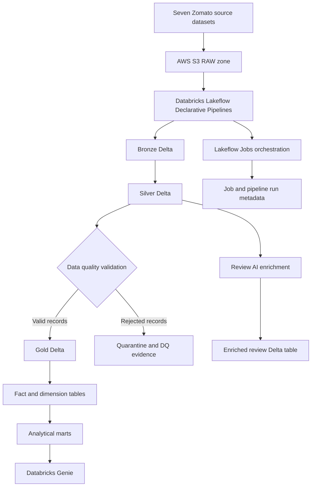
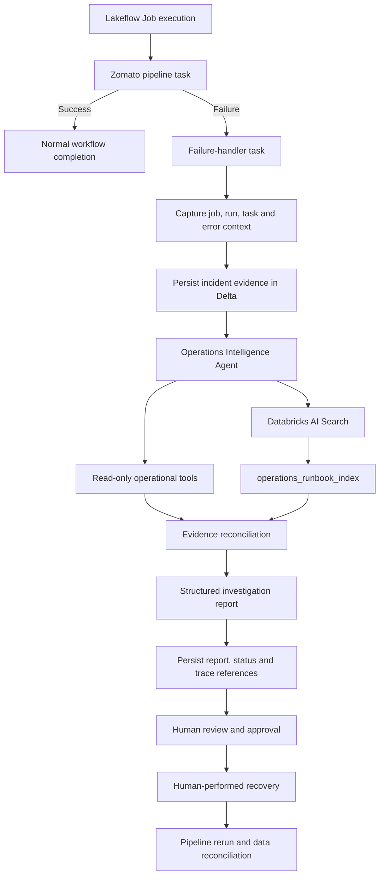

# Zomato Lakehouse & Operations Intelligence Agent

A Databricks-native data engineering capstone that combines a multi-layer Zomato Lakehouse with an evidence-driven Operations Intelligence Agent. The platform ingests and models seven Zomato datasets, applies data quality controls, produces analytical Gold tables, enriches customer reviews with AI, and investigates pipeline failures using structured operational evidence and project-owned runbooks.

> **Project status:** 30-day portfolio capstone completed.  
> **Project classification:** Engineering portfolio prototype. It demonstrates production-oriented design practices, but it is not a certified production service and carries no production SLA.

[](https://www.databricks.com/)
[](https://aws.amazon.com/s3/)
[](https://www.python.org/)
[](https://delta.io/)
[](LICENSE)

---

## Table of contents

- [1. Project overview](#1-project-overview)
- [2. Business and engineering objectives](#2-business-and-engineering-objectives)
- [3. Architecture](#3-architecture)
- [4. Source datasets](#4-source-datasets)
- [5. Lakehouse implementation](#5-lakehouse-implementation)
- [6. AI capabilities](#6-ai-capabilities)
- [7. Operations Intelligence Agent](#7-operations-intelligence-agent)
- [8. Incident lifecycle and persistence](#8-incident-lifecycle-and-persistence)
- [9. Observability and evaluation](#9-observability-and-evaluation)
- [10. Thirty-day engineering journey](#10-thirty-day-engineering-journey)
- [11. Repository structure](#11-repository-structure)
- [12. Technology stack](#12-technology-stack)
- [13. Configuration and deployment](#13-configuration-and-deployment)
- [14. Validation strategy](#14-validation-strategy)
- [15. Security, governance and operational boundaries](#15-security-governance-and-operational-boundaries)
- [16. Design decisions and trade-offs](#16-design-decisions-and-trade-offs)
- [17. Known limitations](#17-known-limitations)
- [18. Demonstration walkthrough](#18-demonstration-walkthrough)
- [19. License](#19-license)

---

## 1. Project overview

This project has two connected workloads with deliberately separate responsibilities.

### A. Zomato Lakehouse and business analytics

The data platform ingests seven source datasets from AWS S3 and processes them through Bronze, Silver and Gold layers using Databricks Lakeflow Declarative Pipelines, Spark/PySpark and Delta Lake.

It provides:

- Source-preserving ingestion and traceability metadata.
- Canonical Silver schemas and controlled type conversion.
- Data quality validation, quarantine and processing evidence.
- Deduplication, incremental processing and replay-safe patterns.
- Gold fact, dimension and analytical mart tables.
- AI-based review enrichment.
- Natural-language analytics over governed Gold tables using Databricks Genie.

### B. Pipeline Operations Intelligence Agent

The Operations Intelligence Agent investigates failed pipeline runs. It combines structured operational evidence from Databricks with relevant project-owned runbooks retrieved through Databricks AI Search.

It provides:

- Job, task, pipeline, schema and data quality evidence collection.
- Targeted selection of read-only investigation tools.
- Runbook retrieval with document and section provenance.
- Structured incident classification and evidence-grounded explanations.
- Explicit reporting of confirmed facts, likely causes, alternatives and missing evidence.
- Safe next-step recommendations and escalation when evidence is insufficient.
- Idempotent investigation persistence and human approval records.
- MLflow tracing for the real investigation workflow.

The agent is an investigator and recommender. It is **not** an autonomous remediation system.

---

## 2. Business and engineering objectives

The project addresses two practical data engineering problems:

1. **Building trustworthy analytical data:** raw files must become validated, consistently typed and reusable analytical tables without losing source traceability or silently accepting invalid records.
2. **Reducing the investigation effort after pipeline failures:** engineers need reliable run metadata, data quality results, schema evidence and relevant runbook procedures in one investigation rather than relying on an LLM to guess from an error message.

The engineering objective is not to create a generic chatbot. It is to demonstrate a coherent data platform and an operational workflow with explicit contracts, durable evidence, bounded tools, safe failure behavior and human-controlled recovery.

### Engineering principles

- Preserve source traceability from raw data through curated layers.
- Make data contracts and validation rules explicit.
- Design reruns and duplicate event handling deliberately.
- Persist operational evidence before model invocation.
- Use structured evidence for incident facts and retrieval for procedural context.
- Validate model output; do not trust free-form prose as an operational record.
- Abstain when evidence is insufficient or contradictory.
- Keep all investigation tools read-only.
- Require a human to review and perform data-changing recovery.
- Do not claim performance improvements without measured results.

---

## 3. Architecture

### 3.1 End-to-end platform architecture



### 3.2 Operations Intelligence architecture



The ordering is intentional: incident evidence is persisted before invoking the model. If model serving, retrieval or response generation fails, the underlying incident record remains available for another investigation attempt.

### 3.3 Data plane and operations plane

| Plane | Responsibility | Main components |
|---|---|---|
| Data plane | Move, validate, transform and serve Zomato data | S3, Lakeflow Declarative Pipelines, Auto Loader where applicable, Delta Lake, Unity Catalog |
| Analytics plane | Provide governed business views and review enrichment | Gold tables, Databricks Genie, `ai_classify` |
| Operations plane | Capture, investigate and report pipeline incidents | Lakeflow Jobs, evidence snapshots, read-only tools, AI Search, RAG, MLflow |
| Human control plane | Review proposed actions and perform recovery | Approval records, operator review, controlled rerun and reconciliation |

---

## 4. Source datasets

The project works with seven Zomato CSV datasets.

| Dataset | Approximate profiled rows | Role in the platform |
|---|---:|---|
| `food` | 373,632 | Food reference and product attributes |
| `menu` | 1,179,936 | Menu and restaurant-food relationships |
| `order_items` | 22,998,179 | Order-line transaction detail |
| `orders` | 10,000,000 | Order-level transaction records |
| `restaurant` | 148,544 | Restaurant reference data |
| `reviews` | 300,000 | Customer review and rating data |
| `users` | 100,000 | User reference data |

These counts reflect the dataset profile used during project development. Counts can change if the input snapshot is replaced or refreshed. They are not presented as live production volumes.

The raw source zone is organized by dataset rather than mixing unrelated CSV files. Source contracts and canonical schemas are maintained separately from the raw files.

---

## 5. Lakehouse implementation

### 5.1 Bronze: source-preserving ingestion

Bronze is the traceable landing layer. It retains the incoming source values and adds ingestion context so records can be traced back to their source files and processing runs.

The ingestion metadata pattern includes:

- `_source_file`
- `_source_file_modification_time`
- `_ingested_at`
- `_rescued_data`

Auto Loader is used for incremental file-arrival patterns where appropriate. A static source snapshot is not described as real-time streaming. The ingestion method is selected based on the delivery pattern and replay requirements.

### 5.2 Silver: canonical and quality-controlled data

Silver applies the source contracts and canonical schemas maintained under `schemas/silver_canonical_schema/`.

The Silver processing pattern includes:

- Explicit casting and type normalization.
- Standardized column naming and value normalization.
- Required-field validation.
- Deterministic deduplication based on supported business keys and ordering fields.
- Preservation of invalid records in quarantine where required.
- Rejection reasons and source references for failed records.
- Separation between row-level quarantine and failures that should stop a pipeline task.

The project includes YAML schema definitions for all seven source datasets: food, menu, order items, orders, restaurant, reviews and users.

### 5.3 Gold: analytical facts, dimensions and marts

Gold contains business-ready models built from validated Silver data. Fact grain and dimension keys are defined from the actual source fields and relationships rather than assumed from names alone.

The current transformation code includes:

**Dimensions**

- `dim_customer`
- `dim_date`
- `dim_food`
- `dim_restaurants`

**Facts**

- `fact_orders`
- `fact_order_items`

**Analytical marts**

- `mart_daily_city_revenue`
- `mart_delivery_sla`
- `mart_restaurant_performance`

Gold tables and marts support downstream SQL analytics and the governed Genie experience. Measures are only meaningful where the source data supports the required fields and grain.

### 5.4 Incremental processing and replay safety

The data pipeline uses explicit processing identity and deduplication rules to make repeat execution predictable. File discovery checkpoints and business-level deduplication solve different problems; neither is treated as a substitute for the other.

Validation covers repeated deliveries, duplicate business records, pipeline reruns and recovery after failed execution. Backfills and corrected deliveries are treated as controlled operations with traceable inputs.

---

## 6. AI capabilities

The project deliberately uses separate Databricks capabilities for separate workloads.

### 6.1 AI review enrichment with `ai_classify`

Review enrichment is implemented as a data workload, not as a retrieval chatbot.

The enrichment flow:

1. Reads eligible Silver review records.
2. Applies controlled sentiment and review-aspect labels using Databricks `ai_classify`.
3. Validates output categories and status values.
4. Persists enrichment results to a Delta table, including source review identity and processing metadata.
5. Uses stable record identity and content/function versioning to control repeat enrichment.

The enriched review dataset is maintained separately from the operational runbook knowledge base. Review text is not added to the operational AI Search index.

### 6.2 Genie for Gold analytics

Databricks Genie provides natural-language analytics over selected, governed Gold tables.

The Genie configuration is based on:

- Approved Gold table selection.
- Table and column descriptions.
- Business definitions and metric semantics.
- Example questions and validated SQL references.
- Questions that test ambiguous or unsupported requests.

Genie owns the business analytics use case. The Operations Intelligence Agent does not implement a second text-to-SQL system.

### 6.3 Operational RAG and Databricks AI Search

RAG is used only for operational knowledge needed during incident investigation.

The knowledge base contains project-owned architecture notes, source contracts, data quality rules, pipeline procedures and failure/recovery runbooks. Source documents are stored with a versioned knowledge-base prefix in S3.

The document ingestion process:

1. Discovers project runbook documents.
2. Parses Markdown and PDF content.
3. Preserves source URI, document identity, version and content hash.
4. Chunks documents using section/heading boundaries where possible.
5. Stores chunk text with document, section, version and provenance metadata.
6. Synchronizes the search-ready Delta source to the operational AI Search index.

The configured index is named `operations_runbook_index`. It is dedicated to operational runbooks and failure procedures.

RAG responses validate citations against retrieved chunk identifiers and can return an insufficient-evidence result when retrieval does not support a reliable answer. Project runbooks remain project-owned documentation; they are not represented as externally approved Zomato procedures or production-certified runbooks.

---

## 7. Operations Intelligence Agent

### 7.1 Purpose

The Operations Intelligence Agent receives a pipeline incident or run identifier and builds an evidence-based investigation. It does not infer a root cause from an error string alone.

### 7.2 Governed read-only toolset

The agent uses a narrow set of operational tools:

| Tool | Responsibility |
|---|---|
| `list_job_runs` | Discover relevant Databricks Job runs |
| `get_job_run_details` | Retrieve job, run and task execution details |
| `get_incident_context` | Load the incident record and captured context |
| `get_data_quality_results` | Inspect relevant DQ checks and quarantine evidence |
| `inspect_schema_changes` | Compare expected contracts with observed schema evidence |
| `get_delta_table_history` | Inspect relevant Delta table operations and versions |
| `search_runbooks` | Retrieve relevant runbook chunks from AI Search |
| `get_downstream_impact` | Inspect downstream impact where lineage/dependency evidence exists |

The investigation workflow selects relevant tools for each incident. It does not need to call every tool for every failure. Tool results are structured evidence and are reconciled before the final response is generated.

### 7.3 Investigation workflow

1. Receive a stable incident or run identifier.
2. Load incident context and available run metadata.
3. Identify the failed job, task and error category.
4. Select the relevant read-only evidence tools.
5. Retrieve DQ, schema, Delta history and lineage information as applicable.
6. Search the operational runbook index using observed symptoms and evidence.
7. Compare runbook procedures with the actual incident evidence.
8. Identify confirmed facts, likely cause, alternative causes and evidence gaps.
9. Generate a structured report with evidence and runbook references.
10. Abstain or request more evidence when the diagnosis is not supported.

### 7.4 Structured incident report

The investigation report is designed to keep observations separate from model interpretation. Its contract includes fields for:

- Incident and run identity.
- Failed task and error classification.
- Confirmed observations.
- Likely cause and alternative explanations.
- Evidence references and source provenance.
- Missing or conflicting evidence.
- Relevant runbook references.
- Downstream impact where supported.
- Safe recommended next steps.
- Escalation and human-approval requirements.
- Investigation status and trace correlation.

The agent does not turn a hypothesis into a confirmed fact. It must make uncertainty visible.

---

## 8. Incident lifecycle and persistence

### 8.1 Stable identifiers

The investigation workflow distinguishes identifiers with different lifecycles:

| Identifier | Purpose |
|---|---|
| `incident_id` | Stable identity for the incident, derived from the originating event/run |
| `request_id` | Idempotency identity for one logical request; duplicate delivery reuses the same value |
| `run_id` | Databricks Job run identity |
| `trace_id` | Identity of one investigation execution trace |
| `tool_call_id` | Identity of one logical tool invocation |

A repeated delivery of the same logical request must not create a second investigation merely because the handler or caller retried.

### 8.2 Durable operational records

The project maintains operational evidence and report persistence under the `zomato_dev.ops_evidence` namespace, including:

- `investigation_runs`
- `incident_reports_current`
- `approval_requests`

Knowledge-base and retrieval assets are maintained under the `zomato_dev.ops_knowledge` namespace.

The persistence workflow supports request reservation, replay detection, investigation history and a current incident report projection. The documented idempotency validation demonstrated sequential duplicate-request handling. It should not be interpreted as proof of distributed exactly-once semantics or concurrent-writer safety.

### 8.3 Human approval boundary

Approval records support a controlled state transition such as `PENDING` to `APPROVED` or `REJECTED`.

The agent remains read-only. Approval does not turn the agent into a recovery executor. A human reviews the recommendation, performs the authorized change through the appropriate operational process and verifies the pipeline after the fix.

---

## 9. Observability and evaluation

MLflow tracing is integrated into the real investigation workflow rather than being limited to isolated tracing examples.

The trace boundary covers the investigation stages that are useful for debugging and review:

- Investigation entry and context.
- Selected tool calls and their outcomes.
- Runbook retrieval and returned source references.
- Model invocation.
- Structured response parsing and validation.
- Final investigation outcome.

The evaluation approach considers:

- Root-cause classification correctness.
- Tool-selection correctness.
- Evidence accuracy and completeness.
- Runbook retrieval relevance.
- Citation and grounding validity.
- Recommendation safety.
- Abstention when evidence is missing or contradictory.
- Structured-output validity.
- Latency and usage/cost where exposed by the serving path.

No performance or accuracy percentage is stated in this README because a metric is meaningful only when accompanied by the exact dataset, denominator, evaluation configuration and run artifact. Evaluation results should be published from the actual evaluation run rather than estimated or invented.

---

## 10. Thirty-day engineering journey

The project was delivered over a 30-day implementation sequence. The first 13 days established the data platform; Days 14–30 developed AI enrichment, retrieval and the Operations Intelligence Agent.

| Day | Focus | Engineering outcome |
|---:|---|---|
| 1 | Problem definition | Defined the Zomato data engineering use case and the role of an Operations Intelligence Agent. |
| 2 | Architecture and boundaries | Separated the Lakehouse, analytics and incident-investigation responsibilities; defined the read-only agent boundary. |
| 3 | Source profiling and S3 contracts | Profiled seven CSV datasets, documented source schemas/relationships and organized the S3 raw landing zone. |
| 4 | Lakeflow project foundation | Established the Databricks pipeline project, target catalog/schemas and pipeline execution structure. |
| 5 | First Bronze ingestion | Implemented and verified the first source-to-Bronze ingestion pattern with traceability metadata. |
| 6 | Seven-dataset Bronze ingestion | Extended the ingestion pattern across food, menu, order items, orders, restaurant, reviews and users. |
| 7 | Bronze hardening | Added schema-change/rescued-data handling and source anomaly visibility. |
| 8 | Silver canonical transformations | Applied canonical schemas, explicit casts and standardized Silver transformations. |
| 9 | Deduplication and relationships | Defined deterministic duplicate handling and validated supported entity relationships. |
| 10 | Data quality and quarantine | Implemented validation rules, quarantine handling, rejection reasons and quality evidence. |
| 11 | Incremental processing and replay | Tested repeat processing, deduplication and safe replay behavior. |
| 12 | Gold dimensional model | Built applicable fact, dimension and analytical mart tables from validated Silver data. |
| 13 | Lakeflow Jobs and pipeline verification | Orchestrated and verified the S3-to-Gold pipeline with run monitoring and recovery procedures. |
| 14 | LLM fundamentals for incident analysis | Designed compact incident evidence context using job/run/task metadata and relevant operational signals. |
| 15 | Prompt and context engineering | Defined a versioned structured incident-report contract and validated model output with Python/Pydantic. |
| 16 | AI review enrichment | Implemented controlled review sentiment/aspect enrichment using Databricks AI Functions and persisted results to Delta. |
| 17 | Genie analytics | Configured governed natural-language analytics over curated Gold tables instead of building a custom text-to-SQL agent. |
| 18 | Operations knowledge base | Designed project-owned runbooks, data contracts, quality rules and incident/recovery procedures. |
| 19 | Document parsing and provenance | Parsed operational Markdown/PDF documents and retained source, version and parsing metadata. |
| 20 | Chunking and lifecycle metadata | Created section-aware runbook chunks with document IDs, versions, hashes and source references. |
| 21 | Embeddings and AI Search design | Defined the operational retrieval source, index schema and Databricks AI Search architecture. |
| 22 | AI Search implementation | Created and queried the operational runbook search index and retrieval interface. |
| 23 | Retrieval evaluation and grounded RAG | Evaluated runbook retrieval, citations and response grounding; added an insufficient-evidence path. |
| 24 | Operations Agent design and model selection | Selected the model/execution approach and defined one bounded Python investigation agent. |
| 25 | Governed operational tools | Implemented the read-only tools for job, incident, DQ, schema, Delta history, runbooks and downstream impact. |
| 26 | Full investigation workflow | Connected incident context, targeted tool selection, evidence correlation, runbook retrieval and structured diagnosis. |
| 27 | Reliability and idempotency | Added stable incident/request/run/trace/tool identities, bounded execution behavior and idempotent persistence patterns. |
| 28 | Persistence and human approval | Validated repeat-request handling, report persistence, approval/rejection transitions and safe abstention behavior. |
| 29 | MLflow tracing and evaluation instrumentation | Integrated MLflow tracing into the real agent workflow and inspected a real historical incident investigation. |
| 30 | Failure-trigger integration and capstone demonstration | Connected the failure-handler path to durable incident evidence, agent investigation, report persistence and human-controlled recovery demonstration. |

### Example incident investigation

A historical failed Job run was used to exercise the investigation workflow. The evidence led to the classification:

- **Category:** `SCHEMA_DRIFT`
- **Subtype:** `SOURCE_CONTRACT_VIOLATION_MISSING_REQUIRED_COLUMN`
- **Observed issue:** required `user_id` column missing from the `users` source input.
- **Evidence completeness:** `PARTIAL`

This example illustrates an important operating rule: the agent can report a likely cause while still stating that the evidence is incomplete. It must not imply certainty that the available operational data does not support.

---

## 11. Repository structure

```text
zomato_lakehouse_pipeline/
├── README.md
├── LICENSE
├── .gitignore
│
├── ai_search/
│   ├── config.py
│   ├── index.py
│   ├── search.py
│   ├── source.py
│   ├── retrieval_evaluation.py
│   └── testing_ai_search.py
│
├── knowledge_ingestion/
│   ├── 02_parse_markdown/
│   │   └── parse_markdown.py
│   ├── 03_parse_pdf_docx/
│   │   └── parse_pdf.py
│   └── 06_chunk_documents/
│       └── chunk_documents.py
│
├── observability/
│   ├── agent_tracing.py
│   ├── config.py
│   └── tracing.py
│
├── operations/
│   ├── agent_tools.py
│   ├── approvals.py
│   ├── data_quality.py
│   ├── delta_history.py
│   ├── evidence_snapshots.py
│   ├── failure_handler.py
│   ├── incident_context.py
│   ├── investigation.py
│   ├── investigation_dispatch.py
│   ├── investigation_workflow.py
│   ├── jobs.py
│   ├── lineage.py
│   ├── persistence.py
│   ├── pipeline_events.py
│   ├── runbooks.py
│   └── schema_inspection.py
│
├── operations_console/
│   ├── app.py
│   ├── app.yaml
│   ├── investigation_jobs.py
│   └── requirements.txt
│
├── rag/
│   ├── rag_smoke_test.py
│   └── response_generator.py
│
├── reviews_ai_enrichment/
│   └── zomato_reviews_enrich.py
│
├── schemas/
│   └── silver_canonical_schema/
│       ├── food.yml
│       ├── menu.yml
│       ├── order_items.yml
│       ├── orders.yml
│       ├── restaurant.yml
│       ├── reviews.yml
│       └── users.yml
│
└── transformations/
    ├── bronze_ingestion/
    │   ├── bronze_food.py
    │   ├── bronze_menu.py
    │   ├── bronze_order_items.py
    │   ├── bronze_orders.py
    │   ├── bronze_restaurant.py
    │   ├── bronze_reviews.py
    │   └── bronze_users.py
    │
    ├── silver_cleaned/
    │   ├── silver_food.py
    │   ├── silver_menu.py
    │   ├── silver_order_items.py
    │   ├── silver_orders.py
    │   ├── silver_restaurant.py
    │   ├── silver_reviews.py
    │   └── silver_users.py
    │
    └── gold_business_ready/
        ├── dim_customer.py
        ├── dim_date.py
        ├── dim_food.py
        ├── dim_restaurants.py
        ├── fact_order_items.py
        ├── fact_orders.py
        ├── mart_daily_city_revenue.py
        ├── mart_delivery_sla.py
        └── mart_restaurant_performance.py
```

The repository contains source code and project documentation. Workspace-managed objects such as Jobs, pipelines, Unity Catalog resources, AI Search indexes, model endpoints and MLflow experiments are configured in Databricks and are not recreated merely by cloning this repository.

---

## 12. Technology stack

| Area | Technology | Responsibility |
|---|---|---|
| Cloud object storage | AWS S3 | Raw Zomato datasets and operational knowledge documents |
| Data engineering platform | Databricks | Unified execution and governance environment |
| Transformations | Apache Spark / PySpark | Data standardization, validation and transformation |
| Pipeline framework | Lakeflow Declarative Pipelines | Bronze/Silver/Gold dataset graph |
| File ingestion | Databricks Auto Loader | Incremental file discovery where applicable |
| Table format | Delta Lake | Lakehouse tables, history and operational records |
| Governance | Unity Catalog | Catalog/schema/table governance and controlled access |
| Orchestration | Lakeflow Jobs | Pipeline dependencies, task execution and failure handling |
| Review enrichment | Databricks AI Functions (`ai_classify`) | Controlled sentiment/aspect classification |
| Business analytics | Databricks Genie | Natural-language access to governed Gold tables |
| Document processing | Python parsing / Databricks document functions where available | Runbook extraction and metadata preservation |
| Retrieval | Databricks AI Search | Operational runbook retrieval |
| Generation | Databricks-served foundation model | Evidence-grounded incident report generation |
| Agent implementation | Python | Investigation logic, tool selection and structured orchestration |
| Output validation | Pydantic | Structured incident response validation |
| Observability | MLflow 3 GenAI tracing | Model, tool, retrieval and workflow trace visibility |
| Operations interface | Streamlit/Databricks App source | Operator-facing investigation experience |
| Version control | Git and GitHub | Source history and collaboration |

---

## 13. Configuration and deployment

### 13.1 Prerequisites

A compatible Databricks workspace and the required permissions are needed to run the project. Depending on the feature being used, the environment must provide:

- Access to the configured AWS S3 raw-data and knowledge-base locations.
- Unity Catalog catalog, schemas and required table permissions.
- Lakeflow Declarative Pipelines and Lakeflow Jobs access.
- A supported SQL/compute execution path for the relevant transformations.
- AI Functions and Genie access for the AI enrichment and analytics workloads.
- A Databricks AI Search endpoint/index and a supported embedding configuration.
- A supported foundation model or serving endpoint for the Operations Agent.
- An MLflow experiment for tracing and investigation observability.

Feature availability depends on workspace edition, region, quotas and current service entitlements.

### 13.2 Configure the environment

Before execution, review the project's configuration modules and set environment-specific values for:

- S3 source prefixes and knowledge-base location.
- Unity Catalog catalog and schema names.
- Source and target table names.
- AI Search endpoint and index identifiers.
- Model-serving endpoint name.
- MLflow experiment configuration.
- Job and pipeline identifiers used by the failure handler.

Keep credentials in the approved Databricks or cloud secret/identity mechanism. Do not hardcode them in source files, notebooks, README examples or traces.

### 13.3 Workspace execution

The intended runtime is Databricks. A typical deployment sequence is:

1. Clone or connect the repository through Databricks Git folders.
2. Review environment-specific configuration before running any workload.
3. Confirm S3 and Unity Catalog access.
4. Publish/run the Lakeflow Declarative Pipeline and verify Bronze, Silver, quarantine and Gold outputs.
5. Configure and run the Lakeflow Job, including the failure-handler path.
6. Configure the AI enrichment and Genie resources supported by the workspace.
7. Ingest operational documents, build/sync the runbook index and verify retrieval.
8. Configure the model endpoint and MLflow experiment, then run the Operations Intelligence Agent.
9. Validate the controlled failure and human-recovery demonstration.

This repository is not an infrastructure-as-code deployment bundle. Cloning it does not automatically provision cloud resources, pipelines, Jobs, catalogs, AI Search indexes, serving endpoints or application resources.

---

## 14. Validation strategy

The project uses a failure-oriented validation approach rather than relying only on successful happy-path runs.

### Data pipeline validation

- Compare source and Bronze row counts and schemas.
- Verify source metadata and rescued-data behavior.
- Validate Silver casts, required fields and canonical schemas.
- Test duplicate business keys and deterministic winner rules.
- Verify valid, quarantined and pipeline-failing records follow the intended rules.
- Reprocess the same delivery and inspect duplicate behavior.
- Reconcile Gold fact grain, dimension keys and analytical aggregates.

### AI enrichment validation

- Validate allowed sentiment/aspect labels.
- Inspect malformed, empty and unsupported inputs.
- Compare a manually reviewed sample with generated classifications.
- Verify repeated processing does not unnecessarily duplicate enrichment output.
- Preserve failed inference states rather than silently dropping them.

### Retrieval and RAG validation

- Query known runbook questions and verify the expected document/section is retrieved.
- Test no-result and ambiguous questions.
- Verify source/version/section provenance.
- Reject unsupported citations and abstain when retrieved evidence is insufficient.
- Ensure stale document versions are not treated as current.

### Agent and workflow validation

- Test known incident categories, including schema drift and missing required columns.
- Validate that selected tools match the incident and that tool outputs are structured.
- Test tool errors, partial evidence and unknown error categories.
- Verify that facts, hypotheses, alternatives and missing evidence remain distinct.
- Re-submit the same logical request and verify idempotent replay behavior.
- Verify `PENDING`, `APPROVED` and `REJECTED` approval states.
- Confirm that the agent cannot execute recovery actions.
- Inspect MLflow traces for the investigation path.
- Exercise the failure-handler path with a controlled pipeline failure and verify evidence persistence before model invocation.

### Validation evidence available from the project work

- A historical failed Job run was investigated and classified as schema drift caused by a missing required `user_id` column in the users source contract; evidence completeness was reported as `PARTIAL`.
- A repeated request using the same request identity replayed the existing persisted result rather than executing a second investigation in the sequential validation scenario.
- Approval and rejection paths were exercised, and the tests confirmed that approval records were persisted without causing the agent to execute recovery actions.
- An unknown-error regression returned an undetermined diagnosis and a safe request for additional evidence rather than inventing a root cause.
- MLflow tracing was integrated into the real investigation workflow and a real historical investigation produced a trace covering the investigation and selected evidence/retrieval/model steps.

These checks demonstrate the behavior exercised in the project environment. They do not establish distributed exactly-once semantics, concurrent-writer safety, production SLA, or a measured accuracy percentage.

---

## 15. Security, governance and operational boundaries

### Read-only agent boundary

- Agent tools are designed for evidence retrieval, not modification.
- The agent cannot autonomously restart jobs, reset checkpoints, replay data, alter schemas, rewrite tables, delete data, change permissions or deploy code.
- Recovery recommendations are reviewed and executed by a human through the appropriate operational process.
- Approval state is recorded, but it does not by itself execute the underlying recovery action.

### Data and prompt handling

- Do not expose credentials or sensitive user fields such as `users.password` in prompts, logs, traces, runbook chunks or search indexes.
- Do not send full source datasets to the model when compact operational evidence is sufficient.
- Retrieved runbook text is project knowledge, not privileged system instruction.
- Keep tool inputs narrow and validate arguments before querying operational metadata.
- Store secrets outside Git and outside the project source tree.

### Runbook governance

The operational runbooks are project-authored portfolio artifacts. They may be eligible for retrieval inside this project, but that does not make them externally approved or certified production procedures. Their document version, source and lifecycle state should remain visible in retrieval metadata.

---

## 16. Design decisions and trade-offs

| Decision | Reason |
|---|---|
| Databricks-native Lakehouse | Keeps ingestion, transformations, governance, orchestration and analytics in the selected platform. |
| S3 as raw storage | Separates source landing from managed analytical tables. |
| Bronze/Silver/Gold | Separates source capture, canonical quality-controlled data and business-ready models. |
| Auto Loader only where useful | Incremental file discovery is appropriate for arriving files; static snapshots do not need to be presented as streaming. |
| YAML canonical schemas | Makes Silver contracts explicit and reviewable by dataset. |
| Quarantine plus quality evidence | Preserves rejected records and explains why they were excluded. |
| Genie for Gold analytics | Avoids building a duplicate custom text-to-SQL agent. |
| `ai_classify` for review enrichment | Treats review labels as governed data outputs rather than a separate review chatbot. |
| One operational AI Search index | Keeps retrieval focused on runbooks and avoids unnecessary vector infrastructure. |
| Structured evidence plus RAG | Operational metadata establishes facts; runbooks supply procedural context. |
| Single custom Python agent | A bounded investigation workflow is sufficient; a multi-agent framework would add complexity without a proven need. |
| Human-controlled recovery | Prevents model-generated recommendations from directly changing production data or infrastructure. |
| MLflow tracing | Makes model, retrieval, tool and workflow behavior inspectable. |

### Explicitly excluded from this project

- Customer-review embeddings or customer-review RAG.
- A second vector database such as PGVector.
- A custom text-to-SQL agent.
- Multiple cooperating agents.
- LangChain/LangGraph as an unnecessary default dependency.
- A custom MCP server without a demonstrated requirement.
- Kafka or a separate streaming platform.
- Airflow, dbt, Snowflake or another parallel orchestration/warehouse stack.
- Autonomous production repair or automatic schema modification.

---

## 17. Known limitations

This is a portfolio prototype built in a Databricks Free Edition learning environment. It is not an enterprise production deployment.

- Free Edition quotas and service availability constrain compute, concurrency, model serving, AI Search and app runtime.
- The workspace does not provide a production SLA or guaranteed availability.
- Some infrastructure and failure scenarios may need controlled simulation when the Free Edition environment cannot expose the underlying failure directly. Simulations must be labelled as simulations.
- Sequential idempotency tests do not prove concurrent-writer safety or distributed exactly-once processing.
- Model output quality depends on the completeness and correctness of operational evidence and runbooks.
- Token usage and cost should only be reported where the active model/API path exposes reliable measurements.
- The source repository does not provision Databricks workspace resources or cloud infrastructure automatically.
- Runbook documents are project-owned and retain their draft/governance lifecycle; they are not official Zomato operational procedures.

The project demonstrates production-oriented engineering patterns. A real production rollout would additionally require organization-specific security review, access controls, environment promotion, infrastructure-as-code, CI/CD, concurrent-load validation, incident response ownership, service-level objectives, cost controls and operational support processes.

---

## 18. Demonstration walkthrough

A technically defensible portfolio walkthrough should follow the data and incident lifecycle:

1. Show the seven raw Zomato datasets in S3 and explain the source contracts.
2. Show Bronze ingestion metadata and source traceability.
3. Show Silver canonical schemas, validation and quarantine behavior.
4. Explain deduplication, incremental processing and replay/idempotency decisions.
5. Show Gold facts, dimensions and analytical marts, including their grain.
6. Show AI-enriched review records and explain the classification contract.
7. Ask Genie a business question over approved Gold tables and validate the answer against SQL.
8. Show the project-owned operational documents, parsed-document table and versioned chunks.
9. Query `operations_runbook_index` and inspect returned source metadata.
10. Show the agent's read-only tool registry and MLflow trace.
11. Run the Lakeflow Job successfully.
12. Inject a controlled failure in an isolated test path and show the failure-handler execution.
13. Verify that the incident evidence is durable before model invocation.
14. Show tool selection, retrieved runbook evidence and the structured incident report.
15. Explain confirmed facts, hypotheses, missing evidence and recommended next steps.
16. Demonstrate the human approval boundary and show the human-controlled fix, rerun and data reconciliation.

### Interview topics this project supports

- Why separate Bronze, Silver and Gold?
- When should Auto Loader be used instead of a one-time batch load?
- How are schema drift and rescued data handled?
- How are quarantine and fail-fast expectations different?
- What makes a transformation idempotent?
- How do fact grain and dimensional keys affect Gold correctness?
- Why use Genie for analytics but a custom agent for incident investigation?
- Why is AI Search limited to operational runbooks?
- How are job/task evidence and retrieved runbooks reconciled?
- How does request-level idempotency prevent duplicate investigations?
- Why is incident evidence persisted before the LLM call?
- How does the agent abstain when evidence is incomplete?
- Why is recovery human-controlled?
- What does MLflow tracing reveal about tool and retrieval behavior?
- Which Free Edition limitations would require a different design in a production workspace?

---

## 19. License

This project is distributed under the MIT License. See [LICENSE](LICENSE) for the full license text.

---

## Author

**Abdul Khadir**  
Data Engineering Portfolio Project

**Repository:** [zomato-databricks-ai-data-engineering-project](https://github.com/Abdulkhadir63/zomato-databricks-ai-data-engineering-project)
